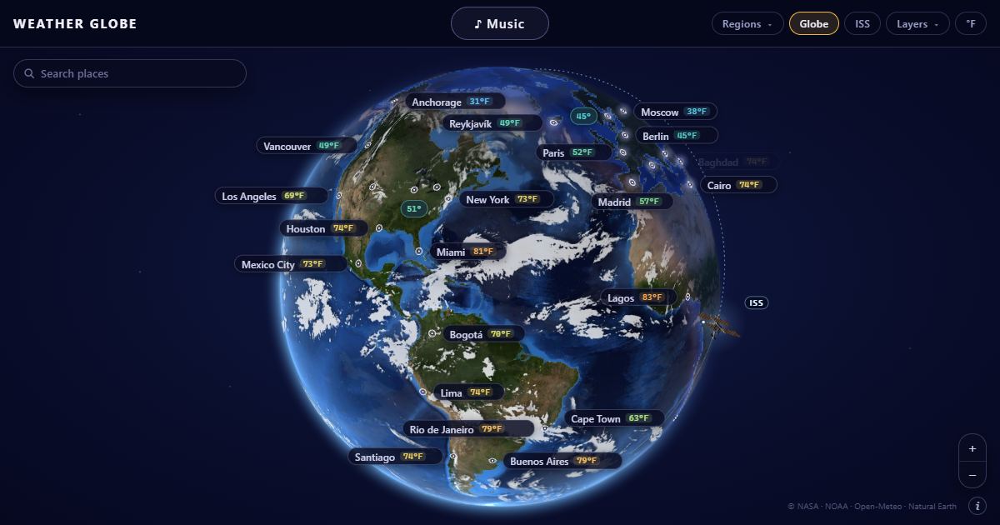

# Weather Globe



A spinnable 3D globe of the weather right now: the real day and night, clouds decoded from live geostationary
satellite infrared, sharp land and cloud detail as you zoom in, current temperatures for ~230 world cities, and a
world music player: the songs people in each place know by heart, on a spinning cassette.

It runs entirely in your browser. There is no server, no proxy and no API key: the page fetches public imagery and
weather data directly from the providers listed below.


## Why it is interesting

- **Hand-written WebGL2, no 3D library.** The whole globe is one fragment shader over one full-screen triangle: it
  ray-casts the sphere per pixel (orthographic), samples NASA's Blue Marble, cuts crisp coastlines from a land mask,
  shades the sun's real terminator with a twilight band and an ocean glint, draws a translucent cloud shell above the
  surface (with parallax, sunset colouring, cloud shadows on the ground and lightning in thunderstorms) and an
  atmospheric limb glow. No three.js, no globe.gl.
- **A satellite infrared decoding pipeline.** NOAA's global infrared mosaic is turned into a cloud field in a Web Worker
  by comparing each pixel with the clear-sky brightness of its latitude and neighbourhood (cold, bright tops are cloud;
  the coldest are high cloud). Zoomed in, NASA GIBS's colour-mapped band-13 tiles from GOES-East, GOES-West and
  Himawari are **inverted back into brightness temperatures** (including blended and resampled colours at cloud edges),
  and their fine structure — how much colder each point is than its surroundings — sharpens the cloud tops.
- **Zoom-in detail tiles.** When the view settles, the visible box is computed from the camera, the right GIBS level is
  chosen for the screen's pixel size, and the tiles are fetched (middle first, rate-limited, de-duplicated) and laid
  into one GPU texture that fades in over the world picture.
- **Weather-model clouds where the satellite is blind.** Open-Meteo's cloud cover on a coarse world grid fills the
  poles and the low cloud infrared cannot see; it is baked into a 4096 × 2048 cloud map with domain-warped noise, a
  strip per frame, so redraws cost the CPU nothing.
- **Labels that stay put, however many cities.** Each city has a tier that sets the zoom it appears at; markers keep a
  minimum spacing (the most important first), pills avoid each other, the markers and the panels over the globe, keep
  their side while the globe turns, and shrink to a small temperature chip where the full pill has no room.
- **Sounds of the world.** ♪ Music marks the cities that have songs; click one (or any city of that country) and its
  song plays on a hand-drawn SVG cassette whose tape winds from reel to reel as the preview plays. Next walks the world
  west to east and the globe flies along; shuffle hops between countries. The cover, the singer's photo and the weather
  where the song is from sit beside the cassette; the OS media keys and lock screen show the song too.

## Run it

Requires Node.js 20 or newer.

```bash
npm install
npm run dev
```

Then open the printed local address (usually http://localhost:5173). Drag to turn the globe, scroll or use `+` / `−`
to zoom, the arrow keys to move, and click a city for its details. The toolbar flies to regions, starts a slow world
tour, turns on the music, toggles the clouds and switches °C / °F.

Other scripts:

```bash
npm run typecheck   # strict TypeScript
npm test            # vitest unit tests
npm run build       # production build into dist/
npm run preview     # serve the production build locally
npm run music       # resolve scripts/music-picks.json into src/data/musicCatalog.json (needs network)
```

### Adding a song

Add a line to `scripts/music-picks.json` — the city it belongs to (an id from `src/data/cities.ts`), the artist, the
title and a genre — and run `npm run music`. The script looks the song up in Apple's iTunes catalogue (the US store,
then the song's own country's store), keeps it only if both artist and title match, and fetches the singer's photo
from Deezer. When the search finds the wrong recording (a remix, a live take, a namesake), pin the exact track with
`"itunesId"` (and `"store"` if it is not in the US store); find the id with
`https://itunes.apple.com/search?term=ARTIST+TITLE&entity=song`. Songs already resolved are kept; `--refresh`
resolves them all again.

A WebGL2-capable browser is needed for the full globe; without it a plain SVG outline globe is drawn.

## Architecture

```
src/
  geo/        pure geometry and data: orthographic projection, sun position, WMO sky codes,
              the GIBS tile grid, Natural Earth land rings
  globe/      the renderer and its pipelines
    globeGl.ts      WebGL2 renderer: the frame shader and the cloud-map bake shader
    camera.ts       camera state outside React (drag, zoom, fly-to, tour)
    detail.ts       zoom-in detail: visible box, tile plan, fetch queue, worker builds
    detailWorker.ts IR tiles → temperatures → cloud fine structure (off the main thread)
    irDecode.ts     NASA GIBS band-13 colour map inverted to °C; fine-structure filter
    satClouds.ts    global IR mosaic → cloud / high-cloud field
    satDecode.ts, satWorker.ts   PNG decode + cloud mapping in a worker
    cloudField.ts   model grid + city reports → GPU cloud textures
    landMask.ts     land / coast / inland mask rasterised from Natural Earth
    labels.ts       label placement
    declutter.ts    which markers show where many cities crowd
  data/       the browser-side fetchers, each throttled and cached
    tileFetcher.ts  NASA GIBS Blue Marble + IR tiles (Cache Storage for surface tiles)
    satellite.ts    NOAA nowCOAST GMGSI mosaic (time list + image)
    weather.ts      Open-Meteo current conditions (cities, in batches + cloud grid)
    cities.ts       the cities, with their country and tier
    music.ts        the song catalog (checked), play order, shuffle
    musicCatalog.json  generated by scripts/resolve-music.mjs
    throttle.ts     concurrency / per-minute limits, Cache Storage and localStorage helpers
    useWeather.ts, useSatellite.ts   React hooks that poll only while the page is visible
  ui/         React: App (toolbar, city panel, caption) and Globe (canvas + SVG markers + HTML labels);
              MusicDock + Cassette (the player), useMusic (the <audio> element), music.css
scripts/      resolve-music.mjs: the hand-picked songs → the catalog
test/         vitest unit tests for the pure modules
```

The camera lives outside React; a move writes positions straight into the SVG and label elements and redraws the
canvas, so turning the globe never re-renders React. Frames are requested only while something changes.

## Data sources & attribution

All data is fetched directly by your browser from the providers below; each answers cross-origin requests
(`Access-Control-Allow-Origin: *`). **You are responsible for respecting each provider's terms and rate limits.** The
code keeps request rates modest: Open-Meteo answers are cached in `localStorage` (cities every hour, the cloud grid
every 3 h), the satellite time list is checked every 20 min and the ~3.5 MB mosaic is fetched only when a newer hour
is published, Blue Marble tiles are kept in the browser's Cache Storage, tile requests are capped at 6 at once and
300 a minute, tiles a service lacks are not asked again for an hour, and nothing is polled while the tab is hidden.

| Source | Used for | Terms |
| --- | --- | --- |
| **NOAA** — [nowCOAST](https://nowcoast.noaa.gov/) Global Mosaic of Geostationary Satellite Imagery (GMGSI, longwave IR) | the world's clouds | U.S. Government work, public domain. Credit: NOAA. |
| **NASA GIBS** — [Global Imagery Browse Services](https://earthdata.nasa.gov/gibs): Blue Marble Next Generation; GOES-East, GOES-West and Himawari ABI/AHI band 13 clean infrared | land imagery, zoom-in cloud detail | Free and open. Please credit: "We acknowledge the use of imagery provided by services from NASA's Global Imagery Browse Services (GIBS), part of NASA's Earth Science Data and Information System (ESDIS)." GOES imagery originates from NOAA; Himawari imagery from JMA. |
| **Natural Earth** — [naturalearthdata.com](https://www.naturalearthdata.com/) 1:50m and 1:110m land (via world-atlas) | coastlines, land mask, SVG fallback | Public domain. |
| **Open-Meteo** — [open-meteo.com](https://open-meteo.com/) Forecast API | city temperatures and conditions, model cloud grid | Free for **non-commercial** use, data under [CC BY 4.0](https://creativecommons.org/licenses/by/4.0/). Credit: "Weather data by Open-Meteo.com". See the [terms](https://open-meteo.com/en/terms); commercial use needs an API subscription. |
| **Apple** — [iTunes Search API](https://performance-partners.apple.com/search-api) | 30-second song previews, covers, Apple Music links | Previews and artwork are Apple's and the labels'; they may be used to promote the music, linking back to it (each song links to Apple Music and YouTube). No API key; the page itself makes no API call — only the preview and cover files load. |
| **Deezer** — [API](https://developers.deezer.com/api) | singers' photos | Deezer's [terms](https://www.deezer.com/legal/cgu). Fetched once by `npm run music`; the page loads the photo files only. |

### Hosting the music

The player loads audio from `https://audio-ssl.itunes.apple.com`, covers from `https://*.mzstatic.com` and photos from
`https://cdn-images.dzcdn.net`. A server that sends a Content-Security-Policy must allow them, and should allow
autoplay for its own page so a song can follow the last one, for example:

```
Content-Security-Policy: … img-src 'self' data: https://*.mzstatic.com https://cdn-images.dzcdn.net; media-src https://audio-ssl.itunes.apple.com; …
Permissions-Policy: autoplay=(self), …
```

Without them the globe works as before; the player says when a song cannot load and asks for a click when the browser
holds a song back.

The page shows these credits in its caption. If you fork this project, keep them.

## License

MIT — see [LICENSE](LICENSE). The data sources above have their own terms.
